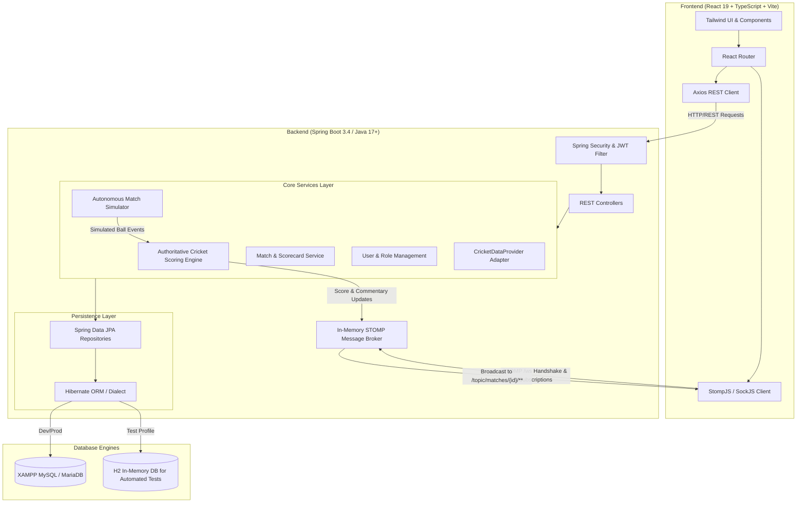
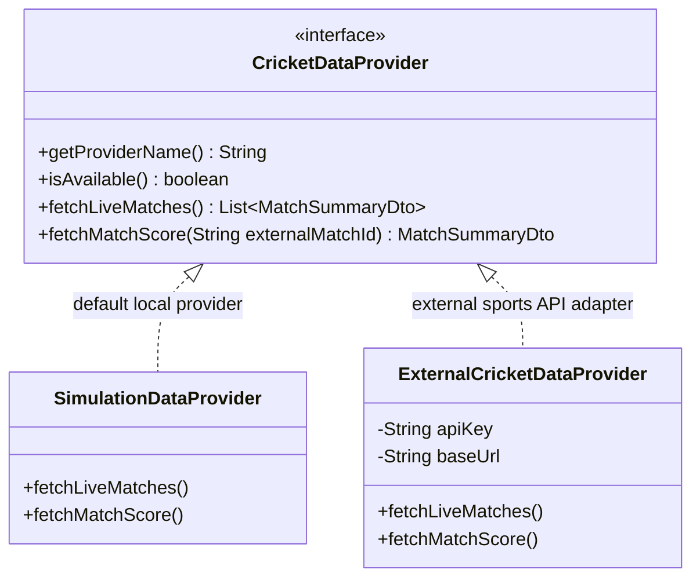

# CricketPulse Architecture & System Design

## 1. High-Level Architecture Overview

CricketPulse is architected as a decoupled, real-time sports score management and analytics platform. It separates the authoritative transactional scoring engine on the backend from high-concurrency real-time WebSocket fan-out and a reactive frontend client.

---

## 2. Real-Time Data Flow & WebSocket Topology

### Channels and Topics:
- **STOMP Endpoint**: `/ws` (with SockJS fallback enabled)
- **Score Broadcast Topic**: `/topic/matches/{matchId}/score`
- **Commentary Broadcast Topic**: `/topic/matches/{matchId}/commentary`

### Transactional Integrity Workflow:
1. Scorer or Autonomous Simulator submits a delivery payload via `POST /api/scoring/innings/{inningsId}/deliveries`.
2. `ScoringService` runs within an active `@Transactional` boundary:
   - Evaluates batter runs, bowler runs, extras, wickets, and legal ball count.
   - Calculates strike rotation and over/innings completion.
   - Updates `PlayerMatchStats` for striker, non-striker, and bowler.
   - Persists delivery record in `deliveries` table.
3. Upon commit, `ScoringService` broadcasts the resulting `DeliveryResponse` to `/topic/matches/{matchId}/score` and `/topic/matches/{matchId}/commentary`.
4. Connected viewer browser sessions immediately update their live score widget, batter ribbon, recent ball progression, and commentary list without requiring page reload.

---

## 3. Extensible External Cricket Data Adapter

CricketPulse includes a provider design pattern via the `CricketDataProvider` interface:

- When running locally without paid API credentials, `SimulationDataProvider` acts as the primary data feed, ensuring the application remains 100% functional.
- When an external API key (such as CricAPI or Sportmonks) is provided in `application.properties`, `ExternalCricketDataProvider` activates seamlessly.
