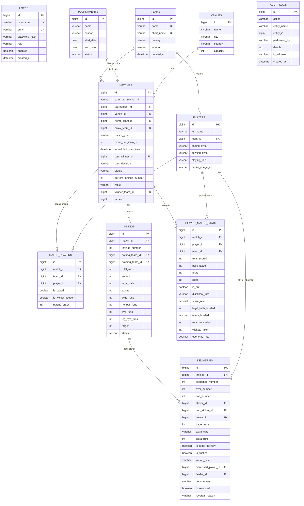

# CricketPulse Database Design & Entity Relationship

## 1. Entity Relationship (ER) Diagram

---

## 2. Indexing Strategy for Performance

- `deliveries(innings_id, sequence_number)`: Enables instantaneous retrieval of delivery sequences and commentary feeds.
- `matches(status, scheduled_start_time)`: Optimizes dashboard queries for live, upcoming, and completed matches.
- `player_match_stats(match_id, player_id)`: Enforces unique constraint per match-player and speeds up scorecard lookups.
- `users(username)` & `users(email)`: Enforces unique credentials and accelerates JWT authentication.
